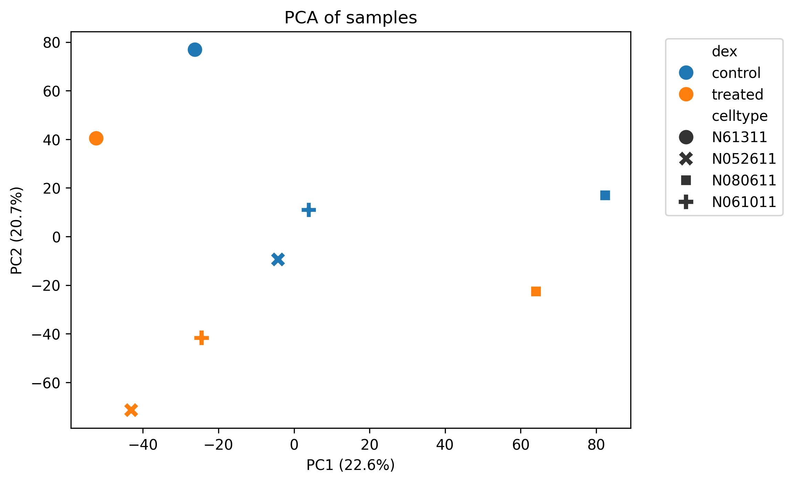
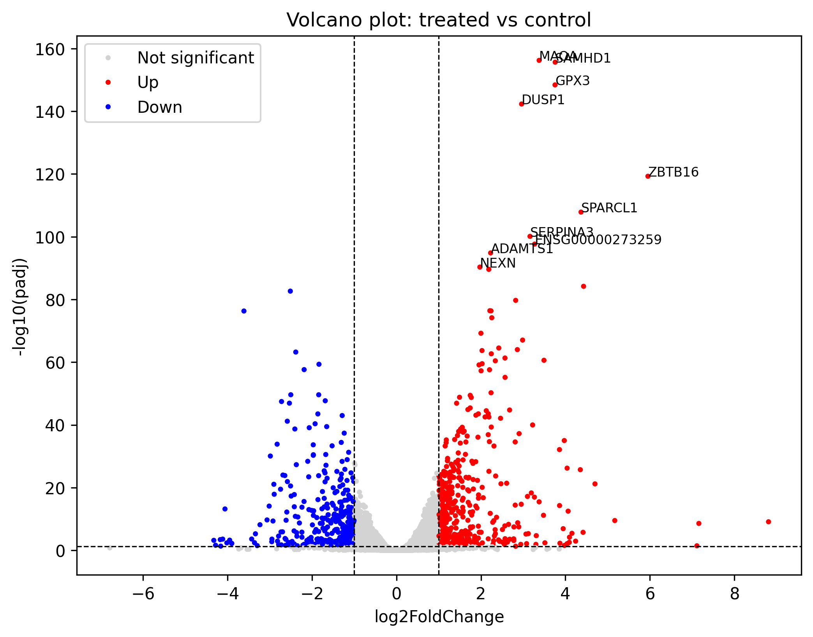
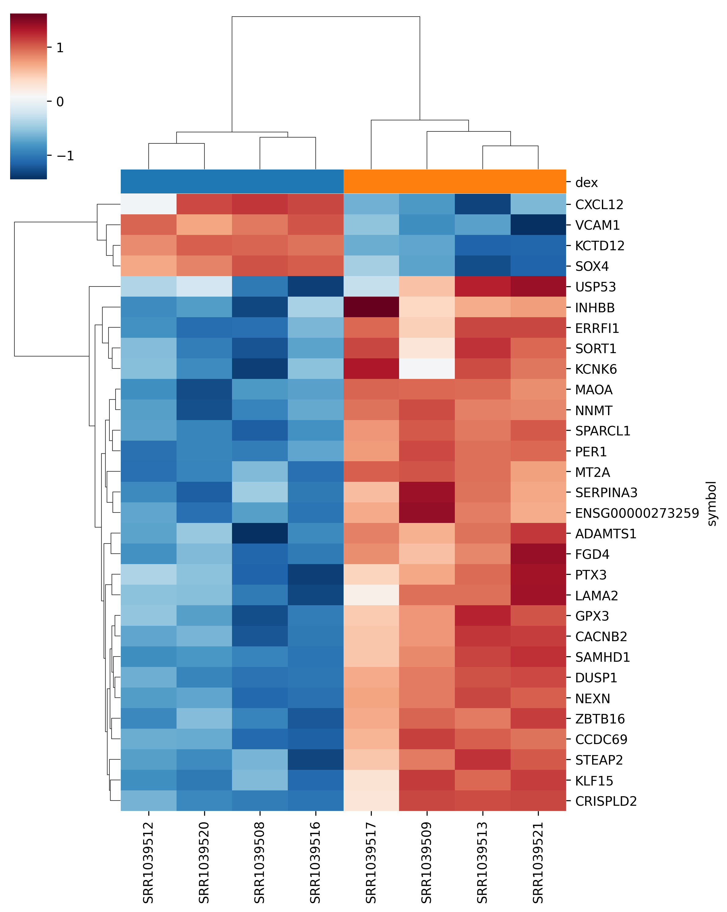
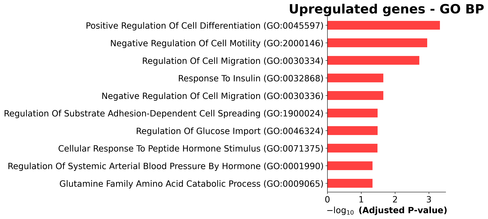
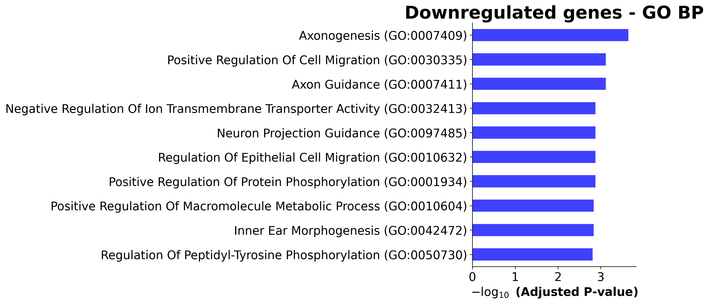

RNA-seq Differential Expression Analysis: Dexamethasone in Airway Cells

Open In Colab

In this project I analyzed RNA-seq data from human airway smooth muscle cells treated with dexamethasone, a corticosteroid used to treat asthma, and compared them to untreated cells. The goal was to find which genes change after treatment and which biological processes they are involved in.

Dataset
Source: GEO GSE52778 (Himes et al., 2014)
Samples: 8 samples from 4 cell lines, each one treated and untreated
Input: gene count matrix
Workflow
Load the count matrix and sample metadata
Filter low count genes (total count < 10)
Differential expression with PyDESeq2 (design: ~celltype + dex)
PCA of samples
Volcano plot and heatmap of top genes
GO enrichment analysis with Enrichr (gseapy)
Results
PCA

The first PC mostly separates the cell lines, but within each cell line the treated sample is always lower than its control on PC2. Because the differences between donors are large, I included celltype in the DESeq2 design.

Differential expression

Using padj < 0.05 and |log2FoldChange| > 1, I found 431 upregulated and 384 downregulated genes out of 19,271 tested genes.

Known glucocorticoid target genes like DUSP1, ZBTB16, KLF15, PER1 and CRISPLD2 were among the top genes.

Top 30 genes

The top 30 genes clearly separate the treated and control samples.

GO enrichment
 
Upregulated genes: negative regulation of cell migration, response to insulin and glucose import
Downregulated genes: positive regulation of cell migration and axon guidance
Conclusion

Dexamethasone changed the expression of many genes in airway smooth muscle cells, including well known glucocorticoid targets. The enrichment results suggest that the treatment may reduce cell migration, which could be related to less airway remodeling in asthma.

Limitations: small sample size (4 cell lines), one dose and one time point only, and cells grown in culture.

The full analysis and discussion are in the notebook.

Tools

Python, PyDESeq2, pandas, NumPy, scikit-learn, matplotlib, seaborn, mygene, gseapy

How to run

Open the notebook in Google Colab using the button at the top and run all cells.

Reference

Himes BE et al. (2014). RNA-Seq transcriptome profiling identifies CRISPLD2 as a glucocorticoid responsive gene that modulates cytokine function in airway smooth muscle cells. PLoS ONE 9(6): e99625.
